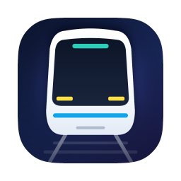
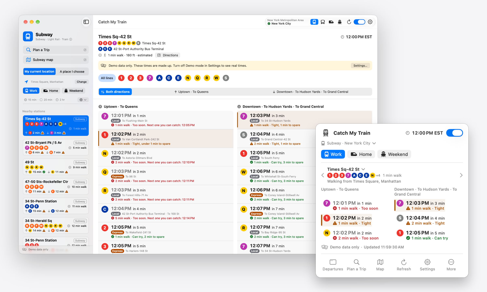
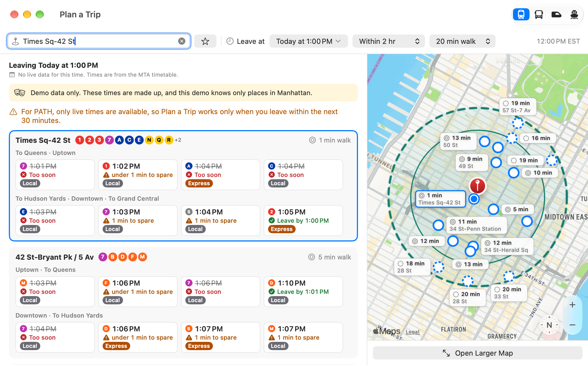
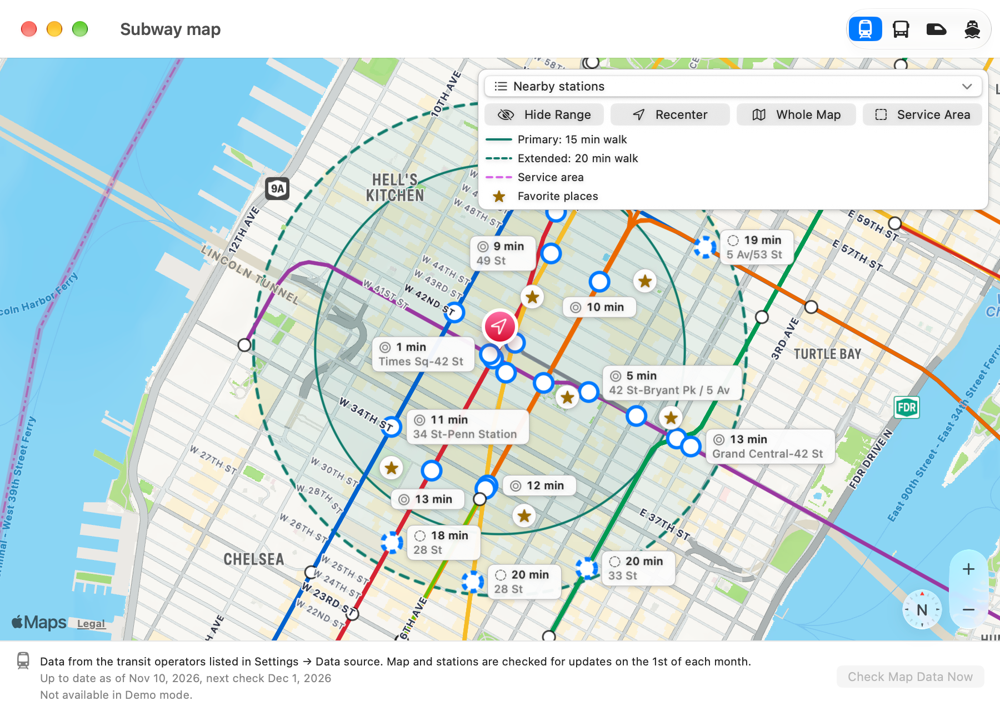
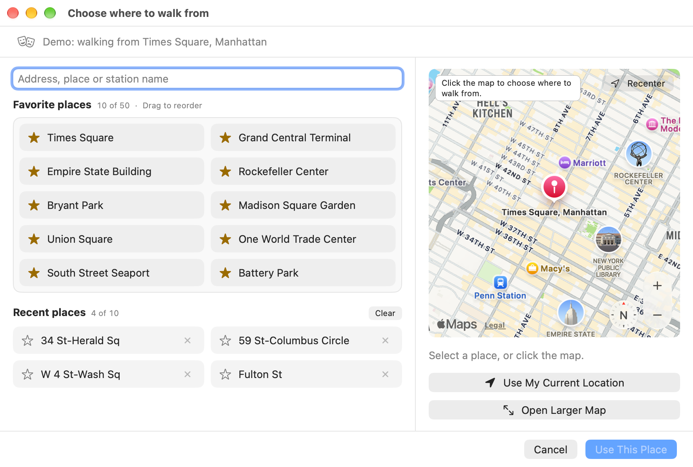
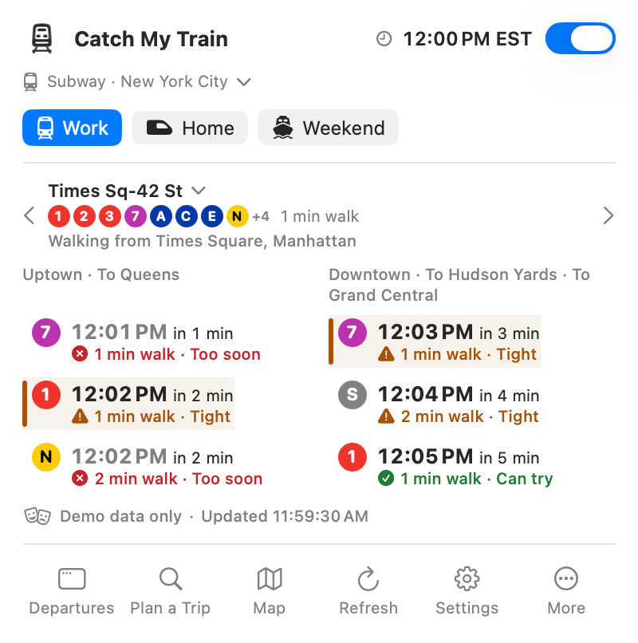
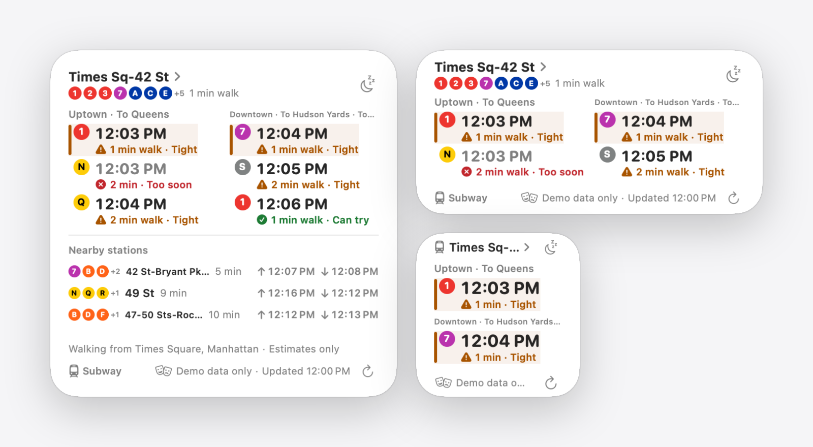
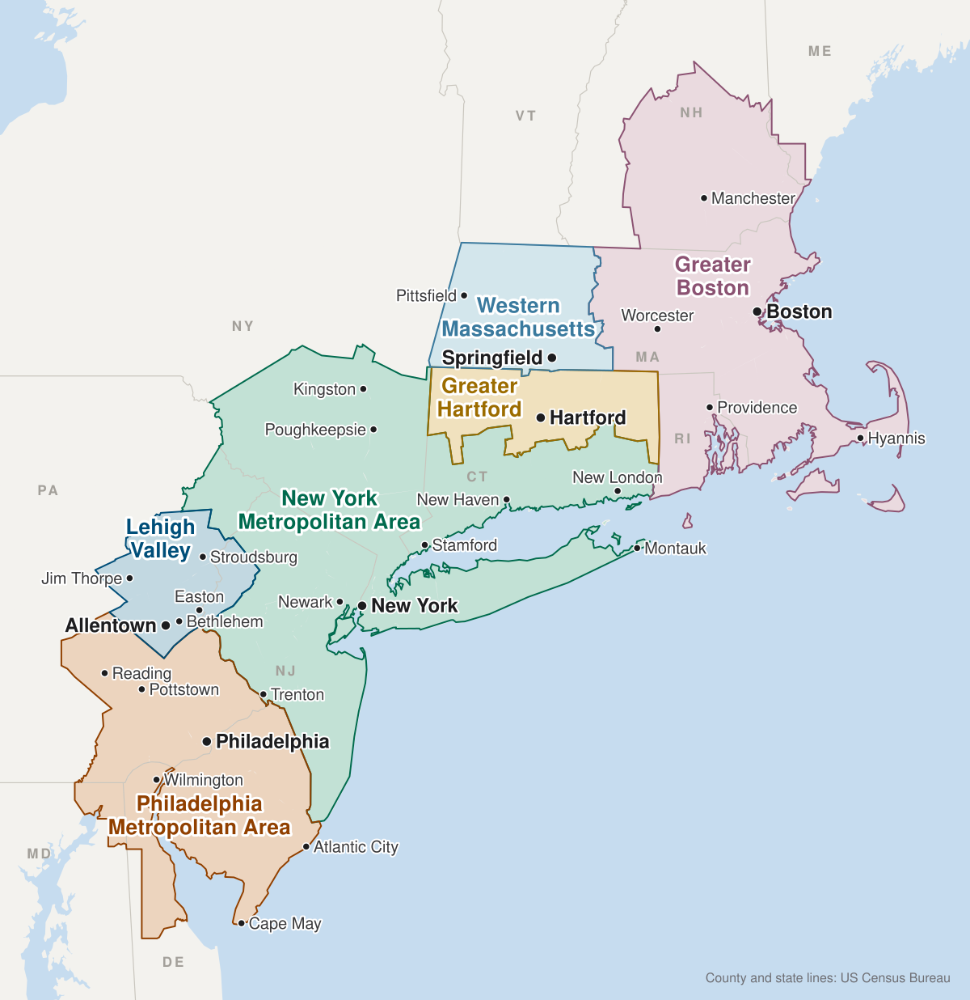

<p align="center">

</p>

<h1 align="center">Catch My Train</h1>

<p align="center">
<b>Leave at the right moment. See what you can still catch.</b><br>
A native macOS app and widget for subway, bus, train and ferry departures near you.
</p>

<p align="center">

</p>

It answers one question: **which subway, bus, train or ferry near me can I still catch?** It works in <!-- generated:intro -->six metro areas<!-- /generated:intro --> (see the [service area](#service-area) below). For every departure near you it shows when it arrives, how long the walk takes, and whether you will make it. It is not a navigation app: it doesn't plan routes. **Directions** hands the walk to a station over to Apple Maps or Google Maps.

The app is fully translated into 23 languages, and languages written right to left get a fully mirrored layout. See the [full language list](#languages) below.

**More details:** [Features](docs/features.md) · [How it works](docs/how-it-works.md) · [Data sources](docs/data-sources.md) · [Design guidelines](docs/design.md) · [Security and privacy](SECURITY.md) · [How Catch My Train started](#how-catch-my-train-started)

**Try it without installing: [▶ Interactive demo](https://cheecar.github.io/Catch-My-Train/interactive-demo.html)** — or download this repository and double-click `docs/interactive-demo.html` to run it locally. Switch modes, pick a station, and see whether you can still catch each departure. Walk from Times Square or from a place you choose on the demo's sketch of Manhattan, move and zoom the map, plan a trip, use a commute preset, try Standby, and see the menu bar panel and widgets. All times are made up.

## App preview

<pre>    </pre>

<sub>← Scroll sideways to see more → · Plan a Trip · Subway map · Choose a Place · Menu bar · Widgets<br>All from Demo mode, so the times are made up.</sub>

## Main features

- **Four modes:** Subway, Bus, Train and Ferry.
- **Can I catch it?** The train's time, your walk time and a clear verdict for every departure.
- **Both directions** of a station side by side.
- **Walk from anywhere:** your current location or any place you choose.
- **Extend Range for Now:** include stations a little farther away.
- **Plan a Trip:** departures near another place at a later time.
- **Leave-by reminders:** a notification a few minutes before the latest time to leave for a departure.
- **Commute presets:** switch your starting place and mode in one click.
- **Maps** with official line colors and your walking range.
- **Menu bar and widgets** in sync with the app.
- **Start / Standby:** no automatic downloads and no location on standby.
- **23 languages**, including right-to-left layouts.

See [Features](docs/features.md) for the full list.

## Service area

<!-- generated:service-area -->
The app covers six metro areas, shown on the map below. [Data sources](docs/data-sources.md) has a page for each, with the counties and cities it covers, and [How the metro areas are drawn](docs/metro-areas.md) says why those counties. Outside them, the app shows "Outside the service area".

<details open>
<summary><b>Service area map</b> (click to collapse)</summary>
<br>


</details>
<!-- /generated:service-area -->

## Install

Requires macOS 14 (Sonoma) or later on a Mac with Apple Silicon.

1. Download the newest DMG from [Releases](../../releases).
2. Open it and drag **Catch My Train** to **Applications**. The **How to Install and Open** item in the same window has these steps in your Mac's language, and **About the Widget** next to it says what to do after each update if you use the desktop widget.
3. Open Catch My Train from Applications. The app isn't notarized by Apple, so macOS blocks it the first time: go to **System Settings → Privacy & Security** and click **Open Anyway**. It does this again after each update, and then also asks again whether the app may use your location. If you've added keys or accounts in the app, macOS then also asks for your login keychain password, once for each one: enter it and click **Always Allow**.
4. On first launch, the **Ready to Go** window helps you allow location, turn on Open at login and add the widget. Each one is optional. Until you finish it, the app downloads nothing and doesn't ask for your location.

The DMG on Releases is the version to install. The code in this repository can be newer than the latest DMG; to run it, build it yourself (see [Build](#build)). The app's update check only looks at Releases, so it won't tell you about newer code here.

Known issues and what to do about them: [pinned issue](https://github.com/CheeCar/Catch-My-Train/issues/1).

### Desktop widget on this unsigned build

Catch My Train isn't signed by Apple, so macOS doesn't treat a new version as the same app. The widget works, but after each update:

1. Open the new version once.
2. Restart your Mac, or log out and back in. Until then, macOS keeps running the widget from the older version.
3. If the widget is gone from your desktop, add it again.

In the app, **Settings → Running → Widget** tells you when the widget is still the older version. Your favorites, recent places and settings are kept when you update.

## Uninstall

1. In Catch My Train's **Settings → Running**, turn off **Open at login**. If you added keys or accounts, remove them in **Settings → Data source → Keys and accounts**: click **Change key…** (or **Change account…**), then **Remove Key** (or **Remove Account**). They're kept in your Keychain, not in the app's folders.
2. Remove the widget from your desktop (right-click it and choose **Remove Widget**), then right-click the menu bar icon and choose **Quit Catch My Train**.
3. Move **Catch My Train** from Applications to the Trash.
4. Move the app's data folders to the Trash. macOS protects most of them, so deleting them in Terminal fails with "Operation not permitted"; use Finder instead. Paste these lines into Terminal one at a time: each one selects a folder in Finder, and **⌘⌫** moves it to the Trash. The last folder is left only by older versions; if Terminal says it doesn't exist, skip it.
   ```
   open -R "$HOME/Library/Containers/com.cheecar.CatchMyTrain"
   open -R "$HOME/Library/Containers/com.cheecar.CatchMyTrain.Widget"
   open -R "$HOME/Library/Application Support/com.cheecar.CatchMyTrain"
   open -R "$HOME/Library/Group Containers/com.cheecar.catchmytrain.shared"
   ```
5. Delete the app's folders in Application Scripts and its folder in macOS's cache folder, if they're there. These work in Terminal:
   ```
   rm -rf "$HOME/Library/Application Scripts/com.cheecar.CatchMyTrain" "$HOME/Library/Application Scripts/com.cheecar.CatchMyTrain.Widget" "$HOME/Library/Application Scripts/com.cheecar.catchmytrain.shared"
   rm -rf "$(getconf DARWIN_USER_CACHE_DIR)com.cheecar.CatchMyTrain"
   ```
6. Empty the Trash and restart your Mac. After the restart, Catch My Train is gone from the login items, Location Services and the widget gallery by itself. macOS may still remember that you allowed location, so if you install the app again, it may not ask again. If you didn't turn off **Open at login** first, Catch My Train may still be listed in **System Settings → General → Login Items & Extensions** with a blank icon: select it and click **−** to remove it. Whether you turned it off or not, it may also stay, with a blank icon, in the list of apps allowed in the background below it (**Background App Activity**, or **Allow in the Background** in some versions of macOS). It can't be removed there, but with the app gone it does nothing.

What the app keeps on your Mac, and where, is listed in [SECURITY.md](SECURITY.md#data-stored-on-your-mac).

## How it works

1. **Find nearby stops.** Stations within your walking range are candidates. In the primary range they must also be within the search radius (4,000 ft in a straight line by default).
2. **Work out the walk.** Walk time = Apple Maps walking route ÷ your walking speed (4.5 km/h by default). If no route is available, it uses straight-line distance × 1.25 and marks the result "estimated". When that straight line crosses a river or a bay, the app waits for the route while online; without one, the station can be at most **Not sure**, with a note that the real walk may be much longer.
3. **Get to the platform.** Time at platform = now + walk to the entrance + entrance to platform (about 90 seconds for the subway).
4. **Compare with the train's time.** Slack = the train's time − time at platform. Each train has one time, the one the app shows; Leave by, reminders, Plan a Trip and the widget all use it. The app needs a safety buffer (2 minutes by default) plus extra margin when the walk is only estimated:
   - enough slack → **Can try**
   - some slack, but less than the buffer → **Tight**
   - negative slack → **Too soon**, so take the next one
   - no prediction, or the data is stale → **Not sure**
5. **Sort.** Stations in the primary range come first, then stations in the extended range (15–20 minutes' walk, tagged "Extended range"), each group ordered by walk time. In each direction, departures are listed by time. When one is Too soon or Not sure, the app points out the next one you can catch (Can try or Tight) on the same route.
6. **Refresh.** While started, the app refreshes every 30 seconds by default and shares the results with the widget through a folder on your Mac. With the app closed, the widget updates by itself only for NYC Subway and Staten Island Railway stations and the Roosevelt Island Tram. For every other station or stop, it keeps showing the last data and asks you to open the app.

## Data it uses

The app covers four kinds of transit: **subway** (with light rail and trolleys), **bus**, **train** and **ferry**. For all four it uses real-time data where the operator publishes it, and timetables everywhere else. [Data sources](docs/data-sources.md) has the detailed list for each metro area: every operator, what it runs, whether it has real-time data and whether it needs a key.

- Most real-time feeds need no key. For the few that do, the metro area's page in [Data sources](docs/data-sources.md) says which, how to get the key or account and what you see without it. Each person uses their own. Keys and accounts are stored only in the macOS Keychain, never in files or settings.
- Where an operator only publishes a timetable, the app marks it "Timetable" and never presents it as live.
- Where an operator publishes no times the app can use, its stations are still listed, marked "No times", with a button to its website. See [Stations without times](docs/data-sources.md#stations-without-times).
- Timetables and maps are checked for updates once a month, and every day from a week before an operator's timetable runs out until a new one is out. New data replaces the old.
- Walking routes come from Apple Maps.
- When a source fails, the app says so at the stations it affects and tells you whether it's your network or the operator's server.

## Privacy

Your location is used only while the app is started, to work out walking times and name the place you are at. It is sent only to Apple Maps and is not saved. If you choose Google Maps for **Directions**, clicking it opens your browser, which sends your starting point and the station to Google. The widget data on your Mac, in a folder other programs on this Mac can read, holds rounded walking times, which a program on this Mac could use to estimate your location to about a block (see [Security and privacy](SECURITY.md#location)). Leave-by reminders are notifications made on this Mac; nothing about them is sent anywhere. Besides transit operators and Apple Maps, the app connects only to GitHub: to download a short list of where each operator's data is, about once a month, and to check for updates (automatic checks are off unless you turn them on). It sends nothing about you (see [Network](SECURITY.md#network)). Nothing is collected or tracked.

## Languages

On a new install, the app follows your Mac's system language (**System Language** in **Settings → General**, where the language list can also be searched) if it is one of the languages below, including its regional variants (for example, Spanish from Spain uses Spanish (Latin America)); otherwise it uses English. The install guide in the DMG uses the system language too. Updating from an older version keeps the language you already use.

<!-- native-language-names:start -->
| Language | Native name |
|:---:|:---:|
| Arabic<br>(right to left) | العربية |
| Bengali | বাংলা |
| Chinese<br>(Simplified) | 简体中文 |
| Chinese<br>(Traditional) | 繁體中文 |
| English | English |
| French | Français |
| German | Deutsch |
| Gujarati | ગુજરાતી |
| Haitian Creole | Kreyòl ayisyen |
| Hebrew<br>(right to left) | עברית |
| Hindi | हिन्दी |
| Italian | Italiano |
| Japanese | 日本語 |
| Korean | 한국어 |
| Polish | Polski |
| Portuguese<br>(Brazil) | Português<br>(Brasil) |
| Russian | Русский |
| Spanish<br>(Latin America) | Español<br>(Latinoamérica) |
| Tagalog | Tagalog |
| Ukrainian | Українська |
| Urdu<br>(right to left) | اردو |
| Vietnamese | Tiếng Việt |
| Yiddish<br>(right to left) | ייִדיש |
<!-- native-language-names:end -->

<sub><b>How the languages were chosen:</b> The app started in the New York metropolitan area, so the list is based on the languages used there. It starts from the ten languages that New York City's Local Law 30 of 2017 designates for city services: Spanish, Chinese (offered here in Simplified and Traditional), Russian, Bengali, Haitian Creole, Korean, Arabic, Urdu, French and Polish. It adds the languages named by New York State's language access law (Executive Law § 202-a: Italian and Yiddish) and by New Jersey's language access law (P.L. 2023, c. 263: Portuguese and Gujarati); both laws pick their languages from US Census data. The remaining languages (Hindi, Tagalog, Ukrainian, Hebrew, Vietnamese, Japanese and German) are among the languages most often spoken at home in the New York metropolitan area according to the American Community Survey, or are widely used by visitors. If your language is missing, please open an issue.</sub>

## Design guidelines

### Accessibility

Verdicts are never told by color alone: each has its own icon shape and word. The app's own colors are tested for WCAG contrast in light and dark, and the ones shown together in three color-blindness simulations. Screen readers read each departure as one sentence. Animations stop when Reduce motion is on, the text can be made larger in Settings, and languages written right to left use a fully mirrored layout.

What isn't done yet is listed in the full [Design guidelines](docs/design.md), with the rules for color, text, buttons and windows.

### Equality and respect

Catch My Train treats everyone the same and with respect, wherever they are. How that shapes its text, messages and maps is in the [Design guidelines](docs/design.md#equality-and-respect).

## How Catch My Train started

If you ride the subway in New York City, this may sound familiar: three trains on the same line arrive within three minutes, and if you miss all three, the next one is more than ten minutes away. Uneven service like this has always been a headache for me on NYC transit.

On any given day I could be anywhere in the city. When I want to ride, I don't want to wait around on the platform. I just want to know: if I leave now, can I still catch the train I need?

You might ask: why not use the official MTA app, or plan the trip in a map app? For me, the MTA app shows when trains arrive at a station, but not whether I can get there in time from where I am. Map apps often assume I can't make the next train. Even when I'm already on the platform and a train is two minutes away, they won't suggest it, which makes planning hard. And once I choose transit, they assume I'll take transit the whole way, which isn't flexible enough for me.

So I built Catch My Train around what I actually need. It shows me what I can still catch nearby and leaves the route up to me.

## Build

Requires Xcode 16 or later (Swift 5 language mode).

1. Set your Developer Team (a free Personal Team works): in the repository folder, copy `Local.xcconfig.example` to `Local.xcconfig` and replace `YOUR_TEAM_ID` with your 10-character Team ID. Git ignores `Local.xcconfig`, and all four targets, including the two test targets, read the team from it.
   - To find your Team ID, open Keychain Access, double-click your **Apple Development** certificate and look at **Organizational Unit**. No certificate yet? Create one in Xcode under **Settings → Accounts → Manage Certificates**.
   - Don't pick a team on the **Signing & Capabilities** tab. Xcode would save it in the project file, and a repository test fails when the project file contains a team.
2. Open `CatchMyTrain.xcodeproj`.
3. Choose the `CatchMyTrain` scheme and press **⌘R**. Press **⌘U** to run the tests. The core logic can also be tested with `swift test` in `Packages/CatchCore`.

## Acknowledgements

Catch My Train was programmed mainly by AI tools. [Claude](https://claude.ai) by Anthropic was the main tool. Other tools, including [ChatGPT](https://chatgpt.com) by OpenAI, [DeepSeek](https://www.deepseek.com) by DeepSeek and [Gemini](https://gemini.google.com) by Google, also helped.

## Copyright and trademarks

- **This app.** The source code, app icon, documentation and interactive demo are Copyright (c) 2026 CheeCar and licensed under the PolyForm Noncommercial License 1.0.0 (see [License](#license)).
- **Transit data.** Timetables, maps, stop locations and real-time predictions belong to the operators that publish them and are not covered by the app's license. The data files that come with the app are listed in [Data sources](docs/data-sources.md#data-files-that-come-with-the-app), each with where it comes from. Everything else is downloaded on your Mac from the public feeds of the operators listed there, some of them through the hosting services named there. All data is used under each provider's terms.
- **Names and symbols.** Operator names, line names, route symbols and line colors are trademarks of their operators and appear only to identify the service. This app is not affiliated with or endorsed by any transit operator.
- **Apple.** Walking routes, map imagery and address search come from Apple Maps. Apple, macOS, Apple Maps and SF Symbols are trademarks of Apple Inc.
- **Google.** **Directions** can open in Google Maps if you choose it in Settings. Google Maps is a trademark of Google LLC.
- **Third-party code.** None. The app uses only Apple's system frameworks.

## License

Free and non-commercial: [PolyForm Noncommercial License 1.0.0](LICENSE).

Required Notice: Copyright (c) 2026 CheeCar

Transit data and trademarks are not covered by this license: see [Copyright and trademarks](#copyright-and-trademarks).
